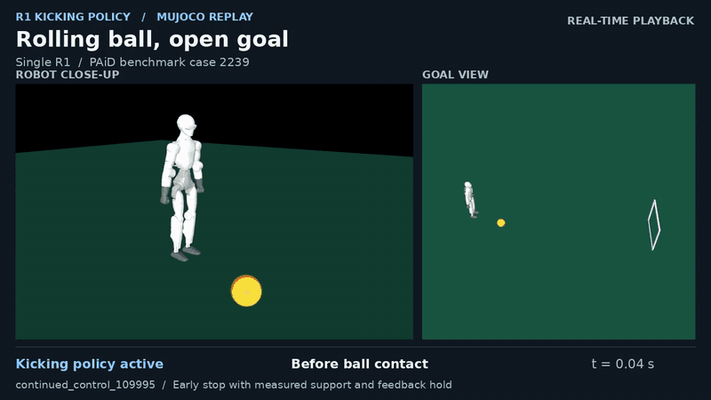

# R1 BitBot simulation checkpoint

November 9, 2026 · Unitree R1 · MuJoCo · 50 Hz control

The four R1 robots on our team use the FreiBots walking policy and the PAiD-based single-kick policy. BitBot navigation publishes `cmd_vel`. The simulation balance controller takes over when the robot settles before and after a kick.

## Kicking demonstration

[](media/r1_kick_demo.mp4)

[Watch the 16-second MP4](media/r1_kick_demo.mp4) · [Download the MP4](https://raw.githubusercontent.com/xp561/HumanoidSoccer/refs/heads/release/r1-bitbots-sim-20261109/ckp/r1_bitbots_sim_20261109/media/r1_kick_demo.mp4) · [Replay provenance](media/demo_provenance.json)

Both clips show real-time MuJoCo trajectories using the published `continued_control_109995` ONNX. The first is a selected rolling-ball benchmark trial. The ball crosses the open goal line and the R1 comes to a stable stand. The second is from the eight-robot test with moving opponents. The goalkeeper saves the shot and the striker recovers to a stable stand.

## Models

| Skill | Training checkpoint | ONNX interface | Files |
|---|---|---|---|
| Kicking | `continued_control_109995` / `model_109995.pt` | 143 observations, explicit LSTM state, 24 actions | [ONNX](kick/policy.onnx) · [Runtime metadata](kick/metadata.json) |
| Walking | FreiBots `model_10000.pt` | 415 observations, 24 actions | [Upstream ONNX (repository access required)](https://github.com/pfrangl/freibots_rl_lab/blob/1f700a97656577865524b58e6d7df8d4aae5bfaa/data/checkpoints/r1_velocity/2026-10-22_21-21-33/exported/policy.onnx) |

The kicking bundle contains the exact ONNX file used in the simulations. Re-exporting the training checkpoint yielded an identical computation graph. Outputs also matched exactly on 200 individual samples and a 200-step recurrent replay. The export differed only in the ONNX `producer_version` field. The `checkpoint` field in the frozen runtime metadata names the earlier baseline that supplied the interface. The release manifest identifies the actual weight source and records both model hashes. [Release manifest](manifest.json) · [ONNX verification](kick/validation.json)

## Validation results

| Test | Result |
|---|---|
| PAiD core grid, open goal | Early stop scored **2,889/3,150 (91.71%)** on stationary balls and **2,770/3,150 (87.94%)** on rolling balls. Goal decisions matched the same R1 running the fixed eight-second reference in all 6,300 paired trials. |
| Single R1, scripted approach, open goal | All five scenarios completed the walk, stop, kick and recovery sequence and scored. |
| Eight robots, referee pause and moving opponents | Both 35-second scenarios completed all 1,750 shared control frames. All eight robots finished upright in both runs, with zero robot-to-robot contacts and zero mid-run robot resets. The goalkeeper saved both shots, so the goal criterion failed. |

Each shared-world scenario recorded one completed kick and a verified recovery. The geometric check detected no second forward swing without ball contact. All 1,888 post-recovery samples stayed below the 0.1 rad/s RMS joint-velocity threshold. [Shared-world validation data](team_validation.json)

## Reproduce on the test host

The adapter switches to the terminal reference after effective ball release and hands control to the balance controller once measured support is stable. The ONNX supplies neural inference for this sequence. The shared-world tests used simulator state, scripted opponents and the frozen R1 physics assets. Full autonomous matches and hardware runs remain unverified.

The commands below use the existing isolated `china4070` workspace with BitBot Pixi/ROS 2, the R1 model and motion references, and the upstream FreiBots walking export with its runtime contract. Choose a new output directory for each run.

```bash
cd ~/Downloads/freibots_walk_bitbots_20261109
bash exp/r1_bitbots_adapter/run_freibots_team.sh runs/team/repro_pause \
  --scenario pause_team --seconds 35
```

The kicking work builds on TeleHuman's PAiD project, which is distributed under CC BY-NC 4.0. [PAiD repository](https://github.com/TeleHuman/HumanoidSoccer) · [PAiD paper](https://arxiv.org/abs/2602.05310)
